 

**Founder & Systems Architect.** I design and build systems where business rules, software and automation have to work together.

AI-enabled workflow systems · Python backends and API integrations · Flutter apps · quantitative tooling

 

---

## Public work you can inspect

| Project | What it shows | Stack |
|:---|:---|:---|
| [**Helm**](https://github.com/rakibulmehedi/Helm) | Finance app for freelancers with irregular USD income. Expected, pending and received income are tracked separately, and one safe-to-spend figure shows its full breakdown. Offline-first, PIN and biometric unlock, hash-chained audit log, English and Bengali. Release v0.9.0. | `Flutter` `Riverpod` `Hive` `GoRouter` |
| [**ou_estimator**](https://github.com/rakibulmehedi/ou_estimator) | My independent project: Ornstein–Uhlenbeck parameter estimation in a Flutter app, running on the device. Implements a closed-form OLS fit and an exact-likelihood MLE minimised with a Nelder–Mead optimiser written in Dart. Reports θ, μ, σ, half-life and fit diagnostics, and rejects series that are not mean-reverting. | `Dart` `Flutter` `Isar` |

---

## Private systems — described, not published

**Workflow platform** — multi-tenant content workflows with saga-style orchestration and human approval gates. Inspected transition code checks tenant, expected state and version, and records accepted transitions. Python · FastAPI · PostgreSQL.

**Publishing operations system** — AI-assisted content workflows combining generation, validation, explicit publishing authority, halt controls and delivery reconciliation. Python · FastAPI · Next.js · PostgreSQL.

**Quantitative trading research** — a sequential risk governor with kill-switch and stale-data rejection paths, and design work on a hybrid C++20/Python trading architecture with Kalman-filter and Ornstein–Uhlenbeck state estimation. Research infrastructure; no trading-performance claims.

Source code stays private. I can walk through the design decisions on a call.

---

## How I work

- Agree the outcome and how it will be checked before building.
- Make approvals, failures and retries explicit instead of hoping they don't happen.
- Hand over with a runbook so the system can be operated without me.
- I use AI-assisted engineering, including Claude Code, and stay responsible for architecture, review and acceptance.

**Open to:** workflow implementation and API integration, Flutter apps, and architecture work, each scoped before it starts.

---

## Stack

---

